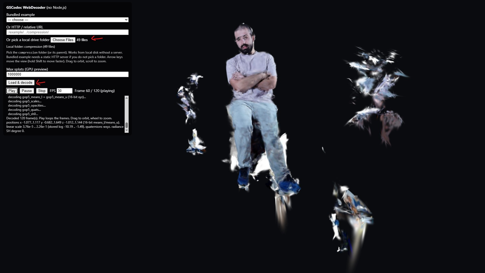

# GSCodec Studio
This is extension of [GSCodec Studio](https://github.com/JasonLSC/GSCodec_Studio), an open-source framework for Gaussian Splats Compression, including static and dynamic splats representation, reconstruction and compression. 
We provided a [Web viewer](./web/gscodec-js/demo) for the MP4 compression files with some [examples](./web/gscodec-js/demo/examples).
A plugin in [viser viewer](./examples/simple_viewer.py) to edit keyframe for video rendering.

## Installation
### Repo. & Environment
Please first clone the repository and cd to the root directory.
```bash
git clone --recursive https://git.mpeg.expert/MPEG/Explorations/GSC/gsc-software/gscodec_studio.git
cd GSCodec_Studio
```

If you are interested in MPEG GSC Video Anchor, please check out related repository:
```bash
git checkout MPEG152_video_anchor_1f_vid
```

Set up conda environment.
```bash
# Make a conda environment
conda create --name gscodec_studio python=3.10
conda activate gscodec_studio
```

### Packages Installation

Please install [Pytorch](https://pytorch.org/get-started/locally/) first. Then, you can install the gsplat library extended with more compression features from source code. In this way it will build the CUDA code during installation.

```bash
pip install .
```

If you want to do further development based on this framework, you use following command to install Python packages in editable mode.
```bash
pip install -e . # (develop)
```

## Examples

**Preparations**

Same as gsplat, we need to install some extra dependencies and download the relevant datasets before the evaluation.

```bash
cd examples
pip install -r requirements.txt
# download mipnerf_360 benchmark data
python datasets/download_dataset.py
```
You can download the Tanks and Temples dataset and Deep Blending dataset used in original 3DGS via [this link](https://repo-sam.inria.fr/fungraph/3d-gaussian-splatting/datasets/input/tandt_db.zip) and place these datasets under 'data' folder.
```bash
# place other dataset, e.g Tanks and Temples dataset, under 'data' folder
ln -s /xxxx/Dataset/tandt data/tandt 
```

We also use third-party library, 'python-fpnge', to accelerate image saving operations during the experiment for now. We also use third-party library, 'gridencoder', to facilitate hash encoding.

```bash
cd ..
pip install third_party/python-fpnge-master
pip install third_party/gridencoder
```

If you are interested in post-training compression, you also need to install library for [vector quantization](https://github.com/DeMoriarty/TorchPQ?tab=readme-ov-file#install) and [plas sorting](https://github.com/fraunhoferhhi/PLAS), before running scripts.
```bash
# refer to https://github.com/DeMoriarty/TorchPQ?tab=readme-ov-file#install to see how to install TorchPQ

# install original implementation of PLAS
pip install git+https://github.com/fraunhoferhhi/PLAS.git
```

### MPEG GSC Activities
If you are interested in MPEG GSC activities, you can find related descriptions in [this file](scripts/README.md). This covers how to run Video-based anchor, how to perform pre and post-processing of Gaussian Splats, and how to conduct Quality Assessment after completing compression experiments.

### Static Gaussian Splats Training and Compression

We provide a script that enables more memory-efficient Gaussian splats while maintaining high visual quality, such as representing the Truck scene with only about 8MB of storage. The script includes 1) the static splats training with compression simulation, 2) the compression of trained static splats, and 3) the metric evaluation of uncompressed and compressed static splats.

```bash
# Tanks and Temples dataset
bash benchmarks/compression/final_exp/mcmc_tt_sim.sh
```

### Dynamic Gaussian Splats Training and Compression

First, please follow the dataset preprocessing instruction described in [this file](mpeg_gsc_utils/multiview_video_preprocess/README.md) for training data prepration.

Next, run the script for dynamic gaussian splats training and compression.
```bash
cd examples
bash benchmarks/dyngs/dyngs.sh
```

### Extract Per-Frame Static Gaussian from Dynamic Splats

If you finsh the training of dynamic splats, then you can use the script to extract static gaussian splats stored at discrte timesteps in ".ply" file
```bash
cd examples
bash benchmarks/dyngs/export_plys.sh
```

### Load .ply File and Render

If you want to directly read and render splats exported as PLY files, you can use the following script.
Note: You need to modify the PLY file path in the scripts.
```bash
cd examples
bash benchmarks/load_ply_and_render.sh
```

## Sequence pipeline

Commands below are run from `examples/`. They use [tyro](https://github.com/brentyi/tyro): the first token is a named preset, and later flags override fields (`--ply-dir`, `--result-dir`, …). Video compression needs `ffmpeg` with libx265.

Typical order:

1. Train a dynamic model and export one PLY per frame (`simple_trainer_dyngs.py`).
2. Encode that PLY folder (`compress_ply_sequence.py`).
3. Decode it back to PLY and inspect it (`codec_ply_sequence.py` or `decode_and_view.py`).
4. Score the bitstreams against a baseline PLY (`eval_encoded_results.py`).
5. Open the same `compression/` folder in the browser (`web/gscodec-js`).

`simple_viewer_dyn.py` is separate: it plays a dynamic `.pt` checkpoint, not a compressed MP4 folder.

### `simple_trainer_dyngs.py`

Trains Spacetime Gaussians. Presets: `default`, `compression_sim` (round quantization during training).

A sequence is split into groups of `--duration` frames (one model per group). `--total-frames` is the length of the clip. After training, pass `--ckpt` and `--enable-dyn-splats-export` to write one static PLY per frame.

```bash
cd examples
# Train. See scripts/train_dyngs_4danyone.sh for a full scene.
python simple_trainer_dyngs.py default \
    --data_dir data/4DAnyone/010_multicam/colmap/colmap_0 \
    --model_path results/dyngs/4DAnyone_010_multicam \
    --result_dir results/dyngs/4DAnyone_010_multicam \
    --duration 60 \
    --total_frames 120 \
    --max_steps 30000 \
    --downscale_factor 1 \
    --test_view_id 0 \
    --no-pin-memory \
    --white-background \
    --prune_z_below None

# Export PLYs from the best checkpoint of one group.
python simple_trainer_dyngs.py default \
    --data_dir data/4DAnyone/010_multicam/colmap/colmap_0 \
    --model_path results/dyngs/4DAnyone_010_multicam/gof_060/group_000 \
    --result_dir results/dyngs/4DAnyone_010_multicam/gof_060/group_000 \
    --duration 60 \
    --ckpt results/dyngs/4DAnyone_010_multicam/gof_060/group_000/ckpts/ckpt_best_rank0.pt \
    --enable_dyn_splats_export \
    --no-pin-memory
```

Exported PLYs land in `<result_dir>/plys/`. Checkpoints land in `<result_dir>/ckpts/`.

### `simple_viewer_dyn.py`

Viser viewer for a trained dynamic checkpoint (temporal opacity, polynomial motion, and rotation). It does not decode `compression/` MP4s.

```bash
cd examples
python simple_viewer_dyn.py \
    --ckpt results/dyngs/4DAnyone_010_multicam/gof_060/group_000/ckpts/ckpt_best_rank0.pt \
    --port 8080
```

Open `http://localhost:8080`. The play control steps the timestamp. The loop in `main` wraps at 50, which matches a 50-frame group; change that modulus for a longer group. `--backend` is `gsplat` (default) or `inria`.

### `compress_ply_sequence.py`

Encodes a folder of per-frame PLYs. The usual preset family is `x265_compression_rp0` … `x265_compression_rp3` (`compression="seq_hevc"`). In that family, rp0 uses the highest QPs and rp3 the lowest. Other presets: `seq_yuv_compression_rp*`, `seq_yuv_compression_newqp_rp*`, `transform_x265_compression_rp*` (YCbCr on SH), `x265_compression_large_shN_qp_rp*`, and `pcc_compression_rp*` (G-PCC, not the web viewer).

`--ply-dir` is either a flat folder of `*.ply` or a 3DGS result folder (`point_cloud/iteration_*/point_cloud.ply`, or `point_cloud_<lod>.ply` with `--ply-lod`). `--frame-num 1` encodes a single static PLY. `--skip-eval` writes the bitstream only and does not need COLMAP.

```bash
cd examples
# One static PLY, bitstream only.
python compress_ply_sequence.py x265_compression_rp3 \
    --ply-dir ../AbbeyStreet_Stairs/ply-result/lod0 \
    --frame-num 1 \
    --gop-size 16 \
    --result-dir results/AbbeyStreet_Stairs/lod0_rp3 \
    --skip-eval

# A dynamic PLY sequence, with render metrics (needs COLMAP in --data-dir).
python compress_ply_sequence.py x265_compression_rp3 \
    --ply-dir results/dyngs/4DAnyone_010_multicam/plys \
    --data-dir data/4DAnyone/010_multicam/colmap/colmap_0 \
    --frame-num 120 \
    --gop-size 20 \
    --result-dir results/geohuman/4DAnyone_010_multicam_16cam_x265_rp3_allintra \
    --scene-type GSC
```

### `codec_ply_sequence.py`

Same PLY input as `compress_ply_sequence.py`, then decodes the bitstream back to PLY. Presets `x265_compression_rp0` … `x265_compression_rp3` match the seq_hevc encoder above (`anchor_type="video"`). Presets `rp0` … `rp4` use `anchor_type="video_codec"` (external HEVC encode/decode). `--decode-only` skips encoding and reads an existing `compression/` folder. `--skip-eval` skips the render comparison.

```bash
cd examples
python codec_ply_sequence.py x265_compression_rp3 \
    --ply-dir results/dyngs/4DAnyone_010_multicam/plys \
    --data-dir data/4DAnyone/010_multicam/colmap/colmap_0 \
    --frame-num 120 \
    --gop-size 16 \
    --result-dir results/geohuman/4DAnyone_010_codec_rp3

# Decode an existing bitstream only.
python codec_ply_sequence.py x265_compression_rp3 \
    --ply-dir results/dyngs/4DAnyone_010_multicam/plys \
    --result-dir results/geohuman/4DAnyone_010_codec_rp3 \
    --decode-only \
    --skip-eval
```

### `decode_and_view.py`

Decodes a `seq_hevc` `compression/` folder (no re-encode), writes reconstructed PLYs, and opens a viser viewer. Pass either the result folder or the `compression` folder itself.

```bash
cd examples
python decode_and_view.py \
    --result-dir results/AbbeyStreet_Stairs/lod0_rp0

# Bitstream folder directly; write PLYs and exit.
python decode_and_view.py \
    --compress-dir results/AbbeyStreet_Stairs/lod0_rp0/compression \
    --ply-dir results/AbbeyStreet_Stairs/lod0_rp0/decoded_ply \
    --no-view
```

The viewer is at `http://localhost:8080` (`--port`). `--frame` selects the first frame. `--keep-padding` keeps the PLAS pad Gaussians (log-scale about -10). The view-list and path-drawer JSON paths default next to the result; override them with `--views-json` and `--path-json`.

### `eval_encoded_results.py`

Finds every `<results-root>/<name>/compression` folder, decodes frame 0, and renders it on the same concentric-ring cameras as `--baseline-ply`. Writes PSNR, SSIM, and LPIPS. No COLMAP. `num_views` must be divisible by `views_per_ring`.

```bash
cd examples
python eval_encoded_results.py \
    --baseline-ply ../AbbeyStreet_Stairs/ply-result/lod0/point_cloud.ply \
    --center-from-ply ../AbbeyStreet_Stairs/ply-result/lod0/point_cloud.ply \
    --results-root results/AbbeyStreet_Stairs \
    --output-dir eva/AbbeyStreet_Stairs \
    --num-views 100 \
    --views-per-ring 10 \
    --radius-step-m 0.45 \
    --ring-height-step-m 0.1 \
    --pitch-down-deg 0 \
    --width 1920 \
    --height 1080 \
    --no-skip-existing
```

Useful flags: `--only name1 name2` limits which result folders run, `--metrics-only` rescores existing PNGs, `--spiral-video-only` skips the still-image metrics and writes the fly-through MP4s (`--render-spiral-video` is on by default). `--merge-environment-baseline` concatenates `environment.ply` next to the baseline PLY into the reference render.

### Result folders

`compress_ply_sequence.py` and `codec_ply_sequence.py` write:

```text
<result_dir>/
  compression/          bitstream the web viewer and decode_and_view.py read
    unity_manifest.json
    gop0_meta.json
    gop0_means_l.mp4    position, low byte
    gop0_means_u.mp4    position, high byte
    gop0_scales.mp4     log-scales
    gop0_opacities.mp4
    gop0_quats_w.mp4    quaternion w
    gop0_quats_xyz.mp4  quaternion xyz
    gop0_sh0.mp4        SH DC
    gop0_sh1_-1.mp4 …   higher SH bands when sh_degree is 3
  stats/                timing and metric JSON
  renders/              comparison images and videos, when eval is not skipped
  decoded_ply/          reconstructed PLYs (codec_ply_sequence.py, decode_and_view.py)
```

An optional environment layer uses the same names with an `env_` prefix. `means` are lossless 16-bit (`(high << 8) + low`, then min–max). Stored scales are log-space. Quaternions are `wxyz`.

`eval_encoded_results.py` writes:

```text
<output_dir>/
  cameras_100.json
  summary.json          PSNR / SSIM / LPIPS per result
  spiral_video/         fly-through MP4s and cameras_spiral.json
```

Shipped examples under `examples/results/` follow the same layout. `examples/results/geohuman/4DAnyone_010_multicam_16cam_x265_rp3_allintra/compression/` is a 120-frame seq_hevc sequence (6 GOPs, SH degree 0). Static scenes such as Abbey Street Stairs are one frame per LOD and rate point (`lod0_rp0` … `lod1_rp3`).

### Web viewer with FFMPEG and Javascript decoder only

`web/gscodec-js` decodes a `seq_hevc` `compression/` folder in the browser and draws it with [Spark](https://sparkjs.dev/) on a Three.js WebGL canvas. No Node.js. Chrome has no HEVC `<video>` decoder, so decode always goes through the ffmpeg.wasm build in `web/gscodec-js/vendor/ffmpeg/`.

From the repo root:

```bash
python -m http.server 8765
```

Open `http://localhost:8765/web/gscodec-js/demo/index.html`.


- **Bundled preset.** The demo’s first preset is `./examples/AbbeyStreet_LowerFloor/lod0_rp0` relative to the demo page. Point that path at a real `compression` folder, or type the repo result directly in the URL box. Then click **Load & decode**.
- **Local folder.** Use “pick a local drive folder” and choose a `compression` directory (or its parent). This works without putting the files on the HTTP server. A shipped bitstream is `examples/results/geohuman/4DAnyone_010_multicam_16cam_x265_rp3_allintra/compression/`.
- **Play / Pause / Stop** loop the decoded frames. **FPS** sets the rate. Arrow keys move the camera (Shift is faster). Drag orbits, the wheel zooms.

Embed the same viewer in another page. The import map must match `web/gscodec-js/demo/index.html` (Three.js 0.180 and `@sparkjsdev/spark` 2.4.0):

```html
<script type="importmap">
{
  "imports": {
    "three": "https://cdn.jsdelivr.net/npm/three@0.180.0/build/three.module.js",
    "three/addons/": "https://cdn.jsdelivr.net/npm/three@0.180.0/examples/jsm/",
    "@sparkjsdev/spark": "https://sparkjs.dev/releases/spark/2.4.0/spark.module.js"
  }
}
</script>
<canvas id="gs" style="width:100%;height:70vh"></canvas>
<script type="module">
  import { createViewer } from "/web/gscodec-js/src/index.js";

  const viewer = await createViewer(document.getElementById("gs"), {
    baseUrl: "/examples/results/AbbeyStreet_Stairs/lod0_rp0/compression/",
    maxSplats: 1_000_000,
    fps: 30,
  });
  viewer.play();    // loop frames
  // viewer.pause(); viewer.stopPlayback(); viewer.setFrame(0);
</script>
```

`maxSplats` only thins the preview. Decode still loads every Gaussian. `play()` needs at least two frames. For a local `FileList`, pass `source: createFileMapSource(files)` instead of `baseUrl`.

## Contributors

This project is developed by the following contributors:

- Sicheng Li: jasonlisicheng@zju.edu.cn
- Chengzhen Wu: chengzhenwu@zju.edu.cn
- Zhiwei Zhu: zhuzhiwei21@zju.edu.cn

If you have any questions about this project, please feel free to contact us.

## Acknowledgement
This project is bulit on [gsplat](https://github.com/nerfstudio-project/gsplat). We thank all contributors from [gsplat](https://github.com/nerfstudio-project/gsplat) for building such a great open-source project.